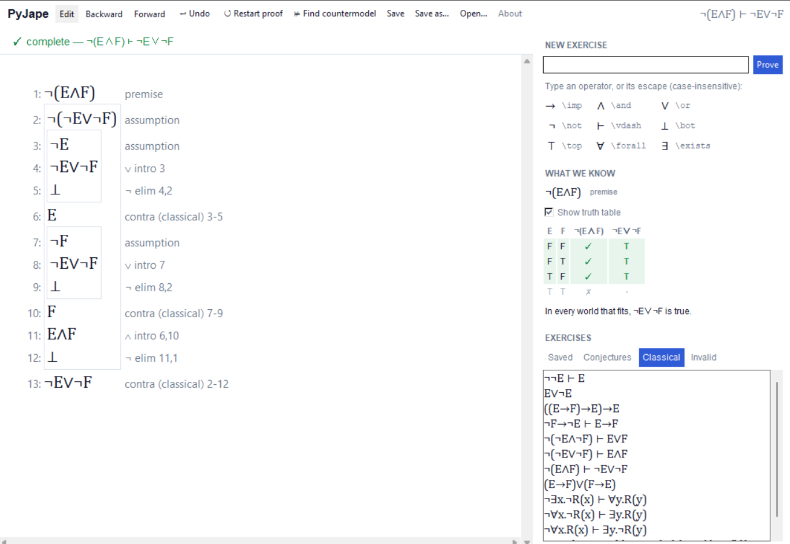

# PyJape

PyJape is a modern, easy-to-install desktop front-end for
**[Jape](https://github.com/RBornat/jape)**, the interactive proof calculator
written by Richard Bornat and Bernard Sufrin. Students can install it and build
natural-deduction proofs on Windows, macOS or Linux without setting up anything
else.




Jape lets you build formal proofs one step at a time. You choose a rule, Jape
applies it, keeps track of what is left to prove, and draws the proof in box
(Fitch) style. PyJape keeps Jape's original proof engine and replaces the old
Java interface with a simpler one built for teaching:

- **Natural deduction out of the box.** PyJape uses Jape's I2L natural-deduction
  logic and comes with its exercise sets.
- **Your own exercises.** Type any conjecture, using the real symbols or
  short escapes such as `\and`, `\imp` and `\forall`.
- **"What we know".** A panel that lists the facts you're allowed to use at the
  step you're working on, respecting proof boxes, with an optional truth table
  for propositional goals.
- **Undo, redo and restart**, plus automatic saving of your own exercises and
  proofs between sessions.
- **Adjustable text size** (Ctrl+= and Ctrl+-), handy on small screens and
  projectors.
- **Countermodels (experimental).** Show that a sequent *can't* be proved by
  building a Kripke model in which its premises hold and its conclusion
  doesn't.

> PyJape is an independent project. It is not affiliated with or endorsed by
> Jape's original authors. All credit for the proof engine and the example
> logics belongs to them.

## Install

Download the file for your system from the
**[Releases page](https://github.com/HamzaBandukara/PyJape/releases)**:

| System | Download | Then |
|---|---|---|
| Windows 10/11 (64-bit) | `PyJape-Setup.exe` | Run the installer. |
| macOS, Apple Silicon (M1 and later) | `PyJape-macos-arm64.dmg` | Open it and drag **PyJape** into **Applications**. |
| macOS, Intel | `PyJape-macos-x64.dmg` | Same as above. |
| Linux (64-bit) | `PyJape-linux-x64.tar.gz` | Extract it, then run `PyJape/PyJape`. |

You don't need to install Python, Java or anything else first.

### First launch: security warnings

PyJape isn't code-signed yet, so the first time you open it your operating
system will warn you. This happens only once.

- **Windows** ("Windows protected your PC"): click **More info**, then
  **Run anyway**.
- **macOS** ("PyJape can't be opened" / "Apple could not verify…"): close the
  message, open **System Settings → Privacy & Security**, scroll down, and
  click **Open Anyway** next to PyJape. (On macOS 14 and earlier you can
  instead Control-click the app and choose **Open**.)

## Using PyJape

1. **Pick an exercise.** The **Exercises** list on the right holds Jape's
   built-in conjectures, grouped into tabs. Double-click one to start a proof.
2. **Or write your own.** Type a sequent under **New exercise**, for example
   `P \and Q \vdash Q \and P`, and press **Enter** or **Prove**. It goes into
   the **Saved** tab.
3. **Apply rules.** Click a formula in the proof to select it. Hypotheses and
   conclusions are highlighted differently. Then choose a rule from the menus at
   the top: **Backward** rules work up from the goal, and **Forward** rules work
   down from what you already know. To select several formulas, Shift-click
   (or Ctrl-click on Windows/Linux, Cmd-click on macOS).
4. **See what you can use.** The **What we know** panel lists the hypotheses
   available at the selected line, or at the first unfinished step if nothing
   is selected. Assumptions from boxes that have closed aren't included. When
   a proof splits into cases (after ∨ elim, for example), the panel says which
   case it's showing; click a line in another case to switch. Tick
   **Show truth table** to check a propositional goal against every possible
   world.
5. **Change your mind.** **Undo** (Ctrl+Z / Cmd+Z), redo (Ctrl+Shift+Z /
   Cmd+Shift+Z), or **Restart proof** to go back to the bare goal. Undo covers
   the steps you make in the current session. A proof reloaded from your saved
   file keeps its earlier steps, and you can't undo past the point where it was
   loaded. **Restart proof** still clears it back to the bare goal.

If a rule doesn't apply to your selection, the status bar above the proof tells
you so. Nothing about the proof changes. When every step is justified, it
shows **✓ complete**. The **About** button on the toolbar shows PyJape's
credits and licence notice.

### Text size

If the text is too small or too large, for example on a projector, change it
from the **View** menu or with the keyboard:

| | Windows / Linux | macOS |
|---|---|---|
| Bigger text | Ctrl+= | Cmd+= (or Ctrl+=) |
| Smaller text | Ctrl+- | Cmd+- (or Ctrl+-) |
| Normal size | Ctrl+0 | Cmd+0 (or Ctrl+0) |

The size goes from 70% to 250% in steps of 10%, and the status bar shows the
current size. Everything resizes straight away, including the proof and the
countermodel. PyJape remembers your choice next time you open it.

### Finding a countermodel (experimental)

> This feature is new and hasn't been fully tested yet. Expect rough edges,
> especially with ∀ and ∃, and please report anything odd.

Some sequents can't be proved; `P ∨ ¬P` is the classic example in Jape's
logic. To show that, build a countermodel: a Kripke model with a world where
every premise holds but the conclusion doesn't.

1. Open the exercise and click **⊭ Find countermodel (experimental)**. A
   countermodel pane opens under the proof, starting with one world.
2. Click a world to select it. Use **+ World above** to add a world, and
   Shift-click a higher world to link it to the selected one or unlink it.
   **Delete world** removes the selected world.
3. Put facts on the selected world by clicking a formula below the model, or by
   typing one into **Put on the selected world** (for example `Q`, `R(i,j)` or
   `actual j`) and clicking **Add**.
4. Each formula in the sequent is coloured green if it holds at the selected
   world and violet if it doesn't. Click a formula in the sequent to see which
   worlds it holds at. The **Reading a countermodel** panel on the right
   explains the rules.
5. When the selected world makes every premise hold and the conclusion fail,
   the status bar says so. Press **Done** to record it. **Start again** goes
   back to one blank world, and **✕ Close** puts the pane away.

A recorded countermodel is saved with your exercises, and the exercise is
marked ⊭ in the list.

### Typing logic symbols

As you type in the **New exercise** box, these escapes turn into symbols
(case doesn't matter):

| Symbol | Type any of |
|:--:|---|
| → | `\imp` `\implies` `\to` `\rightarrow` |
| ∧ | `\and` `\wedge` `\land` |
| ∨ | `\or` `\vee` `\lor` |
| ¬ | `\not` `\neg` `\lnot` |
| ⊢ | `\vdash` `\proves` `\turnstile` |
| ⊥ | `\bot` `\false` `\ff` `\bottom` |
| ⊤ | `\top` `\true` `\tt` |
| ∀ | `\forall` `\all` |
| ∃ | `\exists` `\some` `\ex` |

### Saving your work

Your own exercises and their proofs are saved automatically when you close
PyJape, and they come back the next time you open it. They are stored in:

- **Windows:** `C:\Users\<you>\.pyjape\my_exercises.jp`
- **macOS / Linux:** `~/.pyjape/my_exercises.jp`

**Save** writes to that file straight away. **Save as…** writes a copy anywhere
you like, for example to hand in or back up. **Open…** loads a `.jp` file and
adds its exercises and proofs. The files use Jape's own `.jp` proof format.

Your text-size setting is kept in `settings.json` in the same folder.

## Build and run from source

Most people should use the downloads above. Building from source is for anyone
who wants to read or change the code, or whose system doesn't have a download.

### 1. Get the code

```sh
git clone https://github.com/HamzaBandukara/PyJape.git
cd PyJape
```

Or click **Code → Download ZIP** on GitHub and extract it.

### 2. Run the setup script for your system

Each script sets up everything PyJape needs, compiles the proof engine and
starts the app. Open a terminal (PowerShell on Windows) in the `PyJape` folder
and run:

| System | Command |
|---|---|
| Windows | `powershell -ExecutionPolicy Bypass -File scripts\setup-windows.ps1` |
| macOS | `bash scripts/setup-macos.command` |
| Linux | `bash scripts/setup-linux.sh` |

The first run can take a long time (several minutes at least), mostly because it
compiles OCaml itself. In order, the script:

1. installs whatever is missing:
   - **Windows:** Python 3 and opam, using `winget`.
   - **macOS:** Apple's Command Line Tools (a system dialog opens; when it
     finishes, run the script again), then opam.
   - **Linux:** a C compiler, Python 3 with tkinter and opam's build tools,
     using `apt`, `dnf` or `pacman`. It asks for your password, for `sudo`.
2. creates an OCaml 4.14.2 environment with opam and installs dune;
3. builds the engine into `resources/`;
4. starts PyJape.

After that, **the same command is how you start PyJape**. It skips everything
that's already done and opens the app within seconds. If you pull changes to
the engine source, add `--rebuild` (`-Rebuild` on Windows) to recompile it.

Things to know:

- The scripts make OCaml 4.14.2 your default opam switch. If you already use
  opam for other projects, switch back afterwards with `opam switch <name>`.
- **Windows:** `winget` comes with Windows 10/11 as "App Installer" in the
  Microsoft Store. If the script says Python or opam still isn't found after
  installing it, close PowerShell, open a new one and run the script again.
- **macOS:** you can also double-click `setup-macos.command` in Finder. If you
  downloaded the ZIP, macOS may refuse to open it that way, so use the
  Terminal command instead. If the script says your Python has no tkinter,
  install Python from [python.org](https://www.python.org/downloads/).
- **Linux:** on distributions without `apt`, `dnf` or `pacman`, the script
  lists the packages to install yourself.

### Or by hand

You need **Python 3.9+ with tkinter**, plus **OCaml 4.14 and dune** to compile
the engine once. Then:

```sh
python build/make_dist.py --engine-only   # compile the engine into resources/
python run.py                              # start PyJape
```

[build/BUILD.md](build/BUILD.md) has the step-by-step toolchain setup, how to
build the installers, and how to skip OCaml entirely by reusing a prebuilt
engine.

### Other Jape logics (unsupported)

`resources/examples/` holds every example logic that ships with Jape. PyJape
1.0 is built and tested for natural deduction only. If you're curious, you can
start it on another logic by pointing the `JAPE_ENTRY` environment variable at
that logic's `.jt` file:

```sh
JAPE_ENTRY=resources/examples/sequent_calculus/SCS.jt python run.py
```

Expect rough edges. Sequent calculus loads and works, but the "What we know"
panel doesn't apply to it. Some logics, such as Hoare logic, don't load
properly at all.

## How it works

```
jape/          the Python app: GUI (app.py), engine bridge (engine.py),
               protocol parser (protocol.py), scope + truth tables (logic.py)
engine-src/    the Jape engine's OCaml sources, built into a native binary
resources/     Jape's example logics, plus the built engine
scripts/       one-step "build from source and run" helpers
build/         packaging: make_dist.py, PyInstaller spec, Windows installer
tests/         headless tests that drive the real engine
```

Like the original Jape, PyJape runs as two processes. The proof engine is
compiled from Jape's OCaml sources into a standalone native program, and the
Python/Tkinter app starts it and talks to it over a pipe using Jape's own GUI
protocol. The engine does all the logic. The app draws what the engine tells it
to and sends back your clicks and menu choices.

The engine source is upstream Jape with two small changes (`moresys.ml` and
`env.ml`). They remove its dependency on OCaml's Unix library, which disables
Jape's rarely used "external oracle" feature. Each changed file is marked.

## Tests

The tests need the engine built (see above). They run without a GUI:

```sh
python tests/test_proof.py       # build a ¬¬E ⊢ E proof, multi-select, undo
python tests/test_save.py        # save a conjecture and proof, reload them
python tests/test_scope.py       # "What we know" respects proof-box scope
python tests/test_disproof.py    # countermodel pane: worlds, links, forcing
python tests/test_spacepath.py   # works when installed under a path with spaces
```

## Credits and licence

- **Jape** © 2003–2019 Richard Bornat and Bernard Sufrin
  ([github.com/RBornat/jape](https://github.com/RBornat/jape)). The proof engine
  (`engine-src/`) and the example logics (`resources/examples/`) come from Jape.
- **PyJape front-end** by Hamza Bandukara.

Jape is free software under the GNU General Public License, version 2 or (at
your option) any later version. PyJape includes and distributes the Jape
engine, so PyJape is released under the same licence. See [LICENSE](LICENSE).
The downloadable apps also include Python, Tcl/Tk and the OCaml runtime under
their own GPL-compatible licences; see
[THIRD_PARTY_NOTICES.md](THIRD_PARTY_NOTICES.md).
PyJape comes with **no warranty**.
